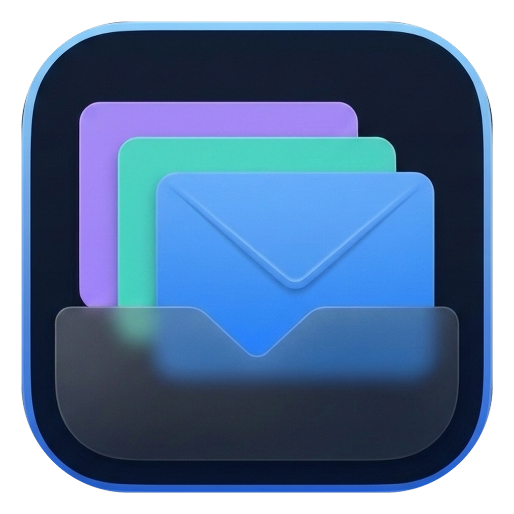
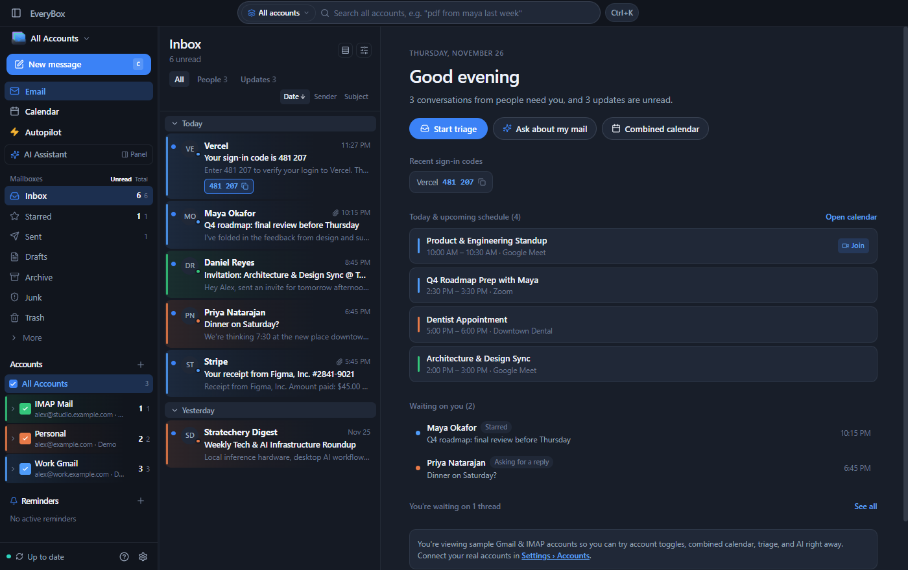
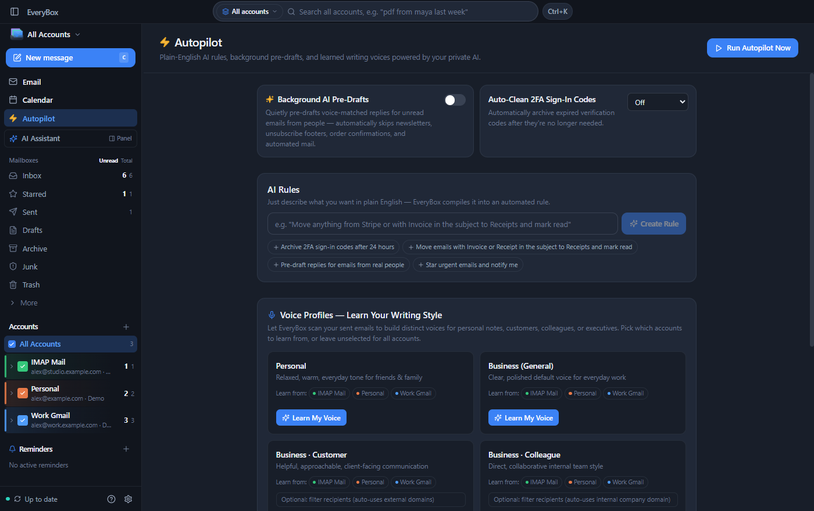
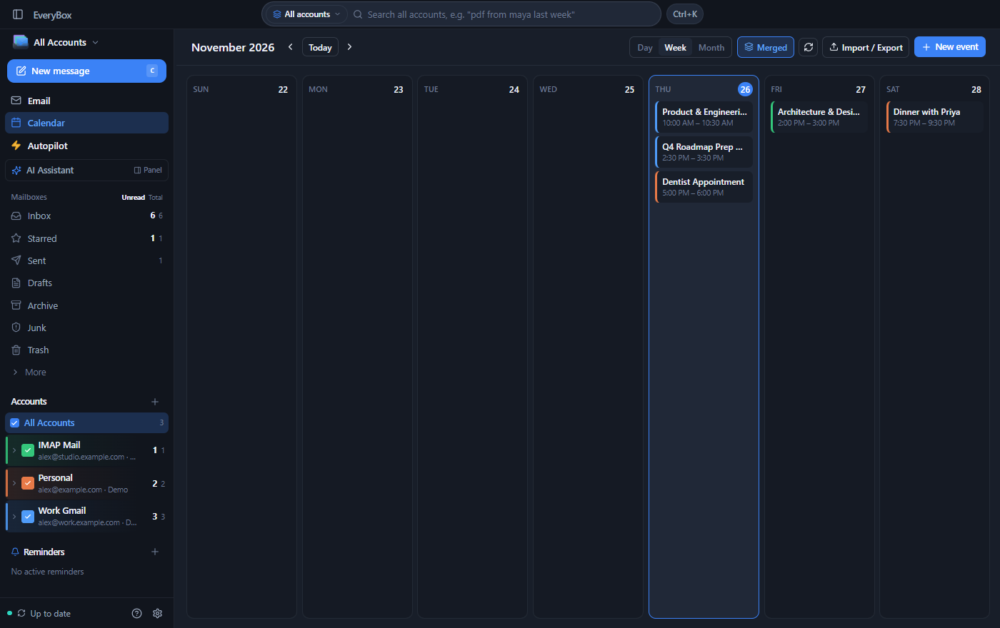
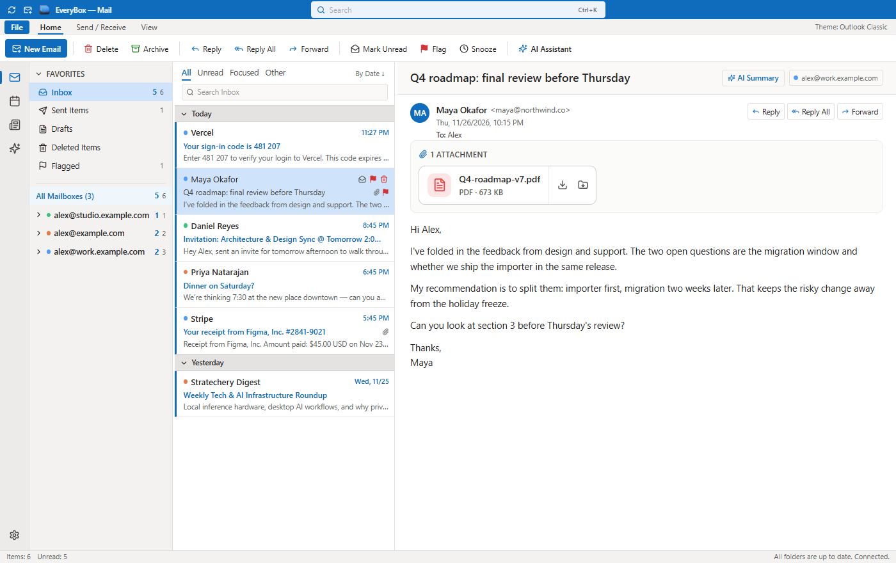
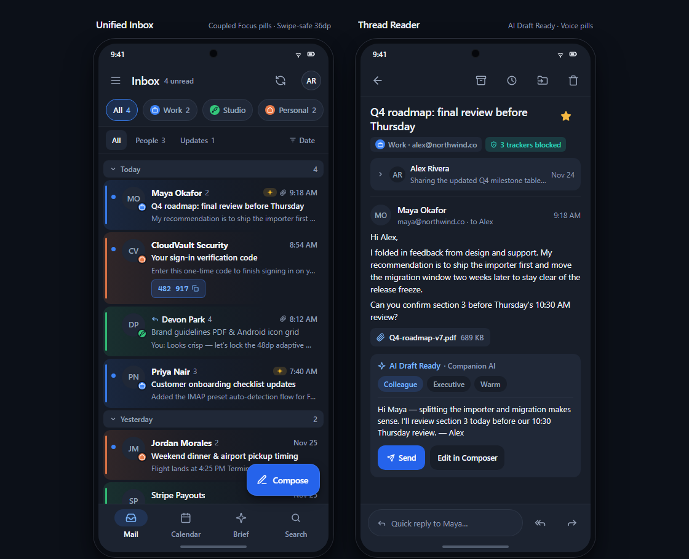

<div align="center">
  
  <h1>EveryBox</h1>
  <p><strong>Every inbox and calendar in one calm Windows desktop app — with multi-account focus toggles, fast private AI, Habit Learning, and a built-in MCP server.</strong></p>
  <p><em>Android companion app now in active build (<code>apps/mobile</code>) · iOS coming next.</em></p>

  <p>
    <a href="https://github.com/SmelterLabs/EveryBox/releases/latest"></a>
    
    
    
    
    
    <a href="https://github.com/SmelterLabs/EveryBox/actions/workflows/ci.yml"></a>
  </p>

  <br />
  
</div>

---

## Why EveryBox?

Most modern email apps force an ugly trade-off: **pay \$20–\$40/month** to hand your entire mailbox to a third-party AI cloud, **fight browser tabs** across 5 different accounts, or **put up with sluggish web-wrapped clients** like New Outlook.

**EveryBox takes a different path:**

- **One Calm Workspace for Every Hat You Wear** — Combine multiple Gmail, IMAP/SMTP, and Classic Outlook accounts alongside a unified calendar, then filter *both* mail and calendar together with 1-click account toggles and `Ctrl+1..9` Workspaces.
- **Two-Speed Private AI Without a Monthly AI Tax** — Pair a blazing-fast **Fast Sorter (Decision AI)** tier for instant classification, priority pills, and implicit calendar event detection with your heavier drafting model — powered by local **Ollama / LM Studio / OpenAI-compatible servers**, your existing **Claude CLI / Codex CLI / Antigravity CLI subscriptions**, or your own API keys (Anthropic, Gemini, OpenAI, Grok). Zero third-party cloud mail proxy sits between you and your inbox.
- **Learns How You Work (Habit Learning + Voice Personas)** — EveryBox quietly observes your real inbox patterns locally and proposes 1-click Autopilot automations (with a **Human Safety Lock** so it never auto-archives people you reply to), while **Voice Personas** (`Personal`, `Business`, `Customer`, `Colleague`, `Executive`, `Custom`) learn your exact tone, greeting, and sign-off from your sent mail.
- **Built for Windows & Classic Outlook Refugees** — Local-first SQLite + FTS5 speed, Windows DPAPI credential encryption, a familiar **Classic Outlook UI mode**, live Classic Outlook COM/MAPI bridge, built-in local calendars for IMAP accounts, and **1-click Classic Outlook calendar import**.
- **Agent-Ready by Design (Local MCP Server)** — Give Claude Desktop, Cursor, or your own local AI agents safe, read-only access to your unified inbox and calendar via EveryBox's built-in **Model Context Protocol (MCP)** server — with `<email_content>` prompt-injection wrapping and per-account, per-folder, and per-sender privacy controls.

---

## Inside EveryBox

<table>
  <tr>
    <td width="50%" valign="top">
      <strong>Autopilot Rules, Habit Learning &amp; Voice Personas</strong><br />
      Plain-English AI rules, background VIP pre-drafts, 2FA auto-clean, Habit Learning rule suggestions, and learned writing voices for Personal, Customer, Colleague, and Executive email.<br /><br />
      
    </td>
    <td width="50%" valign="top">
      <strong>Combined Multi-Account Calendar</strong><br />
      Day / Week / Month views obeying your sidebar account focus toggles, with two-way Google Calendar, CalDAV/ICS, implicit email event detection, and 1-click Outlook import.<br /><br />
      
    </td>
  </tr>
  <tr>
    <td width="50%" valign="top">
      <strong>Classic Outlook UI Mode (1-Click Switch)</strong><br />
      Prefer Classic Outlook's familiar ribbon, favorites, Focused/Other split, and reading pane? Switch UI themes anytime — with AI Summary and AI Assistant built right in.<br /><br />
      
    </td>
    <td width="50%" valign="top">
      <strong>EveryBox for Android (<code>apps/mobile</code>)</strong><br />
      Native Expo/React Native Android companion sharing <code>@everybox/shared</code> logic — coupled Mail + Calendar focus pills, swipe-safe triage with Undo Fuse, and Voice-Matched AI drafts.<br /><br />
      
    </td>
  </tr>
</table>

---

## Ways You Can Use EveryBox

| Persona / Workflow | How EveryBox Makes It Effortless |
| :--- | :--- |
| **Multi-Entity Founder / Fractional Exec** | Create Workspaces (`Ctrl+1` Personal, `Ctrl+2` Company A, `Ctrl+3` Client B). Toggle one account or any subset and watch both your inbox and combined calendar filter instantly. Switch **Voice Personas** per account so replies always match the right role. |
| **Classic Outlook Escape Hatch** | Switch the UI theme to **Classic Outlook**, bridge live Classic Outlook Desktop stores or import local *"Calendar (This computer only)"* folders in one click via Windows COM/MAPI, and keep legacy IMAP accounts (Network Solutions, GoDaddy, Fastmail, cPanel) fast and offline-ready. |
| **5-Minute Morning Triage** | Let the **Fast Sorter (Decision AI)** tag incoming mail with priority pills and pre-draft only threads that actually need a human reply. Open the **Today Brief**, hit `T` for AI-assisted keyboard triage (`E`/`H`/`R`/`J`), and add implicit meeting dates straight to your calendar in 1 click. |
| **Local-AI & Subscription Purist** | Point EveryBox at your local Ollama / LM Studio model (with automatic GPU detection) or connect your existing **Claude / Codex / Antigravity CLI subscription** for \$0 extra API cost. Tracking pixels and remote images are blocked by default, suspicious senders get scam warnings, and expired 2FA codes auto-clean themselves. |
| **AI Agent & MCP Power User** | Connect Claude Desktop, Cursor, or custom local agents to EveryBox's local MCP server (`npm run mcp`). Ask *"What am I waiting on from vendors this week?"* or *"Prep me for tomorrow's meetings"* across all accounts without handing raw Gmail OAuth tokens to every agent. |
| **Self-Optimizing Inbox (Habit Learning)** | Just use your inbox normally — when EveryBox notices you consistently archive, move, or triage a sender or category the same way, it proposes a 1-click Autopilot rule (and permanently mutes any suggestion you dismiss). |

---

## Feature Highlights

### Multi-Account Mail & Focus
- **Multi-Gmail + IMAP/SMTP + Classic Outlook COM:** Native Gmail OAuth2 API sync, universal IMAP/SMTP (`imapflow` + `nodemailer`) with built-in provider presets, and live Windows Classic Outlook COM/MAPI bridging.
- **Workspaces & Focus Toggles:** View all accounts, solo one account, or select any custom subset (`Ctrl+1..9`).
- **People vs. Updates Split:** Separates real human conversations from newsletters, receipts, and automated noise.
- **Themes & UI Layouts:** 5 color themes (`Light`, `Paper`, `Dark`, `Black`, `Graphite`) plus `EveryBox`, `Classic Outlook`, and `Gmail` UI shells.

### Combined Calendar
- **Unified Multi-Account Grid:** Day / Week / Month views obeying your active account focus toggles.
- **Implicit Calendar Event Detection:** Automatically spots dates and times mentioned in regular emails (even without an `.ics` attachment) and surfaces a 1-click **"Add to Calendar"** banner right inside the thread reader.
- **Two-Way Google Calendar + CalDAV + ICS Feeds:** Full Google Calendar sync, optional CalDAV/ICS subscriptions, inline `.ics` email invite RSVPs, and meeting-link extraction (`Join` buttons right in your Today Brief).
- **Local SQLite Calendars + Outlook Import:** Every IMAP account gets a built-in local calendar out of the box, with deduplicated **1-click Classic Outlook COM/MAPI import** and standard `.ics` import/export.

### Private AI, Fast Sorter, Habit Learning & Voice Personas
- **Two-Speed AI Architecture (Fast Sorter + Writer):** Configure a lightweight, fast **Decision AI** tier with a provider priority queue for instant post-ingest sorting, priority badges, and triage — while reserving heavier models for voice-matched drafting and deep synthesis.
- **Flexible AI Backends (\$0 Extra Cost):** Run 100% locally via **Ollama**, **LM Studio**, or any local OpenAI-compatible server; bridge your existing **Claude CLI**, **Codex CLI**, or **Antigravity CLI** subscriptions; or bring your own API keys (Anthropic, Gemini, OpenAI, Grok).
- **Habit Learning Engine:** Locally learns your repetitive inbox habits (archiving, moving, starring, drafting) and suggests 1-click Autopilot rules — protected by a **Human Safety Lock** (never touches people you reply to, VIPs, or security/action threads) and permanent one-click dismissal.
- **Smart 6-Point Auto-Draft Gating:** Automatically pre-drafts replies only when an email actually warrants a human response — skipping newsletters, automated alerts, and FYIs.
- **Voice Personas (Per Scenario & Account):** Scan your own sent emails to learn distinct writing styles — **Personal**, **Business (General)**, **Customer**, **Colleague**, **Executive**, or **Custom** — complete with your greeting, sign-off, and tone, plus optional recipient/domain filtering.
- **Vision / Image-Aware AI:** Reads embedded images and screenshots inside email threads when summarizing or drafting replies.
- **Natural-Language Search & Summaries:** Query locally with plain English (`"pdf from maya last week"`), get instant thread gists + action items + key dates, and chat with your inbox in **AI Assistant**.

### Android Mobile Companion (`apps/mobile` + `@everybox/shared`)
- **Shared Core Architecture:** Monorepo workspace (`packages/shared`) shares types, themes, mail presets, classifier, and search parsing cleanly between Windows Desktop and Mobile.
- **Built for Speed on the Go:** Unified Inbox, coupled Focus Pill Strip, Swipeable Thread Rows with Undo Fuse, Thread Reader, Combined Calendar, Today Brief, Search, Compose, native Kotlin mail bridge, and all 5 canonical themes.

### Little Details That Make a Big Difference
- **Pop-Out Thread Windows:** Pop any email thread out into its own independent window to reference side-by-side while composing or working.
- **Conditional "Only If No Reply" Reminders:** Set follow-up reminders on any thread that automatically cancel themselves if the recipient replies before your deadline.
- **1-Click 2FA Code Copy Pills + Auto-Clean:** Surface sign-in codes right in the thread list and Today Brief, copy in one click, and auto-archive expired codes after a configurable window.
- **Visual Account Identity:** Customize each account with its own color, icon (briefcase, home, rocket, shield, etc.), row style (`gradient`, `bar`, `dot`), and custom sidebar order.
- **Per-Pane Zoom & Reader Width:** Independently zoom panes and toggle Narrow / Comfortable / Wide reading widths for ultrawide monitors.
- **Customizable Keyboard Shortcuts:** Rebind shortcuts to match your Gmail or Outlook muscle memory, with an in-app cheat sheet.
- **Built-in Update Checker & Everyday Polish:** In-app release update notifications, Waiting On You / Waiting On Others tracking, Snooze, Send Later, Undo Send, Snippets (`Alt+Ctrl+S`), Markdown composer, auto-linkified plain-text URLs, multilingual AI responses, and 1-click Subscriptions Unsubscribe.

### Privacy & Security First
- **100% Local Database:** All synced mail, calendar events, Habit Learning profiles, and FTS5 search indexes stay on your machine (`%APPDATA%\everybox\`).
- **Encrypted Credentials:** Passwords and OAuth tokens are encrypted at rest with Windows **DPAPI** (`Electron safeStorage`).
- **Inbox Hygiene:** Tracking-pixel stripping, remote-image blocking with trusted-sender allowlists, and scam warnings.

---

## Quick Start

> **Download the latest Windows build** directly from **[GitHub Releases](https://github.com/SmelterLabs/EveryBox/releases/latest)** — or run from source below.
>
> **Try it immediately with Demo Data:** On first launch (before you connect any real accounts), EveryBox automatically seeds realistic demo accounts, threads, and calendar events so you can explore the UI, Workspaces, Triage, Calendar, Voice Personas, and AI workflows right away. Demo data clears automatically as soon as you connect your first real account.

### Prerequisites (From Source)
- **Windows 10 / 11**
- **Node.js 22+** (uses built-in `node:sqlite`)
- *(Optional)* **Ollama** or **LM Studio** for 100% local AI inference

### Run Locally
```powershell
git clone https://github.com/SmelterLabs/EveryBox.git
cd EveryBox
npm install
npm run dev
```

### Build & Package for Windows
```powershell
npm run typecheck  # TypeScript check (main + renderer)
npm run build      # Production build -> out/
npm run package    # Windows NSIS installer & portable .exe -> dist/
```

Or double-click `launch-everybox.bat` after building to launch the production Electron app directly.

---

## Connect AI Agents via Built-in MCP Server

EveryBox ships with a **read-only local MCP server** (`everybox-windows`) over stdio JSON-RPC 2.0. Enable it in **Settings › MCP**, choose which accounts, folders, or senders to hide, and point your MCP client (Claude Desktop, Cursor, etc.) at the built server:

```json
{
  "mcpServers": {
    "everybox": {
      "command": "node",
      "args": ["C:/path/to/EveryBox/out/main/mcp-server.js"]
    }
  }
}
```

**Exposed read-only tools:** `get_context`, `search_mail`, `overview`, `read_thread`, `list_waiting`, and `upcoming_calendar` — with every email snippet and body wrapped in `<email_content>` tags to defend against indirect prompt injection.

---

## Keyboard Shortcuts at a Glance

| Shortcut | Action |
| :--- | :--- |
| `Ctrl+K` | Open Command Palette |
| `Ctrl+1..9` | Switch saved Workspaces |
| `T` | Start full-window Triage (`E` Archive · `H` Snooze · `R` Reply · `J` Next · `Esc` Exit) |
| `Alt+Ctrl+S` | Insert Snippet while composing |

---

## Roadmap

- **Android Companion Full Native Sync & Companion AI** (finishing live IMAP/Gmail sync and Desktop-to-Mobile companion pairing in `apps/mobile`)
- **iOS Companion App** (built on the same `@everybox/shared` core)
- **Microsoft 365 / Outlook.com OAuth2** (native Mail + Calendar sync alongside Classic Outlook COM import)
- **Standalone Calendars** (Apple iCloud, Fastmail, Yahoo, Zoho, and decoupled CalDAV/ICS feeds)
- **Signed Public Windows Releases & Verified Google Cloud OAuth Client**

---

## Documentation

- [User Guide](USER-GUIDE.md) — Connecting accounts, Classic Outlook import, Workspaces, shortcuts, and AI setup
- [Technical Guide](TECHNICAL-GUIDE.md) — Architecture, SQLite/FTS5 storage, DPAPI security, IPC, and build commands
- [Product Spec](PRODUCT.md) — Product vision, user workflows, and feature specifications
- [Design System](DESIGN.md) — Visual language, themes, typography, and layout details
- [Android Architecture Plan](docs/mobile/ARCHITECTURE-PLAN.md) & [Android Design Spec](docs/mobile/ANDROID-DESIGN-SPEC.md)
